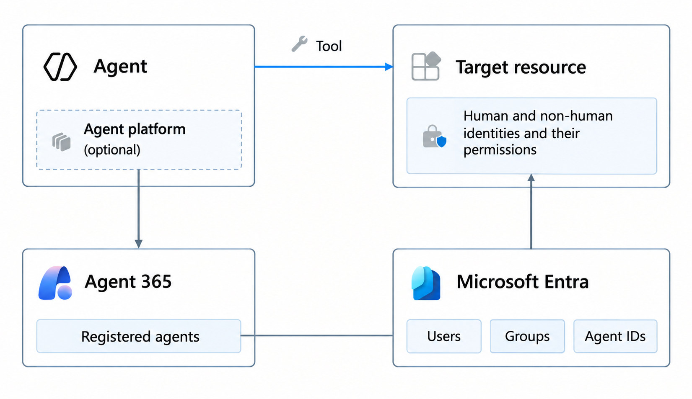

# What is Dynamic permissions? (Preview)

Microsoft Entra Dynamic permissions are new identity governance capabilities that help organizations ensure least privilege for permissions assigned to identities in their applications.

While many organizations already have a zero trust model for employees interacting with applications, agents make zero trust principles even more important. When an agent is assisting an employee, the agent should not automatically inherit all the standing access rights of the employee using it. It should begin with no authority and receive only what it needs for the approved task, for only as long as the task requires.  Similarly, autonomous agents with their own identities need to have only the required permissions for their tasks, and not be assigned permissions which could be misused.

In the Dynamic permissions approach, organization-wide policies sets the outer boundary guardrails for agents, preventing agents from having permissions it should not have.  Permissions are then further scoped to the task, made time-bound, and contracted or removed as the task changes or completes. The permissions assigned to an employee does not change, but an agent may receive its own identity with its own permissions scoped to the task. This new capability is augmented by dynamic agent risk and dynamic conditional access.

A new identity governance preview detects excessive permissions that have been assigned to autonomous AI agent non-human identities in business applications.

## Prerequisites

Dynamic permissions builds upon features in Microsoft Entra, including provisioning account discovery, and entitlement management, with connections to applications to discover identities, evaluate their access, and perform supported remediation.

[!INCLUDE [licensing-dynamic-permissions](../includes/licensing-dynamic-permissions.md)]

## Detection and remediation of overprivileged agent identities (Preview)

An agent's access isn't limited to the platform where it runs. Dynamic permissions focuses on how agents are represented in the applications and resources they access, and what those identities are allowed to do.

### Where agents run and what they access

Agent platforms and resource applications provide different perspectives on an agent:

| Perspective | What it describes |
| --- | --- |
| Agent platform | Where an agent runs and its runtime context. |
| Applications and resources | The systems and data an agent accesses through identities, roles, permissions, and other authorization constructs. |

[Connected platforms in Microsoft Agent 365](/microsoft-agent-365/admin/connected-platforms) focuses on discovering and managing agents from supported agent platforms. Dynamic permissions complements that platform perspective with a deeper understanding of the identities and access represented in important business applications and resources.

An agent can run on one platform and access resources in another application. Understanding its roles and permissions in that resource application helps you identify excessive access, regardless of where the agent runs.

### Agent identity coverage in the preview

The preview supports agent identities in Snowflake. For supported identity types, connection requirements, and setup instructions, see [Tutorial: Mitigate permission risk of agents in Snowflake with Microsoft Entra dynamic permissions](tutorial-dynamic-permissions-prevent-excessive-permissions.md).

### Input for excessive access

The preview starts with two checks: ensuring that agents do not have excessive **privilege level** and are not subject to **separation of duties conflicts**. Together, they help you identify agents with powerful permissions and combinations of access that violate your organization's rules.

- **Privilege level:** Dynamic permissions introduces a canonical privilege-classification model that maps application-specific permissions and roles to **Low**, **Medium**, **High**, or **Critical**. This creates a consistent way to understand authority across different authorization models without replacing them. Classification reflects what a permission or role allows, independently of the resource's sensitivity or business criticality. During preview, dynamic permissions flags agents with permissions or roles classified as **Critical**, such as authority to take ownership, grant access, or change security controls. For details, see [Privilege levels for dynamic permissions](dynamic-permissions-privilege-levels.md).
- **Separation of duties conflicts:** Organizations can define incompatible access using the authorization models and constructs of their applications and resources. For example, a rule can identify a conflict between roles that let an identity modify financial data and independently audit that data. This evaluates combinations of access that shouldn't be held together, rather than only the authority of each role individually. For details, see [Manage separation of duties for dynamic permissions](dynamic-permissions-manage-separation-duties.md).

The separation of duties preview is separate from the generally available [separation of duties capabilities for access packages](entitlement-management-access-package-incompatible.md). Those capabilities check incompatible access package assignments and group memberships when users request access packages. Dynamic permissions adds rules expressed in the connected application's own authorization model.

## Task-scoped permission assignment based on intent

In addition to the detection and remediation preview, a second dynamic permissions preview enables task-scoped permission assignment, allowing agents to dynamically request permissions for a specific task. Dynamic permissions translates the agent's intent and the task it's trying to accomplish into the least-privilege permissions needed to complete that task. This approach was demonstrated at Microsoft Ignite and described in the Microsoft Security blog, [Agents are your newest insiders. Security must move at their speed.](https://www.microsoft.com/en-us/security/blog/2026/10/19/agents-are-your-newest-insiders-security-must-move-at-their-speed/)

Privilege level and separation of duties conflicts inform both excessive-access assessments and task-scoped permission requests. Organizational policy sets the boundaries. Within those boundaries, an agent receives only the permissions needed for a task, for only as long as needed. Permissions can be reduced or removed as the task changes or completes.

Interested customers and ISVs are invited to partner with Microsoft to preview task-scoped permission assignment. To request participation in that preview, [sign up for dynamic permissions updates](https://aka.ms/DynamicPermissionsPreview).

## Related content

- [Governing agent identities](agent-id-governance-overview.md)
