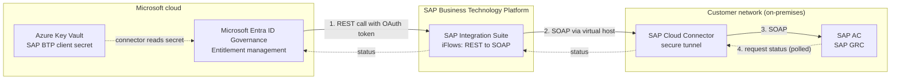

# Microsoft Entra SAP Access Control integration (Preview)

Microsoft Entra ID Governance integrates with SAP Access Control (SAP AC), part of the SAP Governance, Risk and Compliance solution (SAP GRC), so you can govern SAP access from Microsoft Entra. With this integration, you add SAP business roles as resources in entitlement management catalogs and let users request them through Microsoft Entra access packages, while SAP AC continues to run its own approval, risk analysis, and provisioning workflows.

This integration enables you to:

- Add SAP AC business roles as resources in entitlement management catalogs.
- Let users request SAP access through Microsoft Entra access packages and the My Access portal.
- Keep SAP AC as the system of record for SAP-side approval and provisioning.
- Reconcile the SAP request outcome back to Microsoft Entra so the assignment status reflects the SAP result.

Microsoft Entra defines and governs *who can request* access; SAP AC *executes* the request within SAP; and SAP Business Technology Platform (BTP) connects the two in a secure, controlled way.

> [!IMPORTANT]
> The Microsoft Entra SAP AC integration is currently in PREVIEW. See the [Supplemental Terms of Use for Microsoft Azure Previews](https://azure.microsoft.com/support/legal/preview-supplemental-terms/) for legal terms that apply to Microsoft Entra features that are in beta, preview, or otherwise not yet released into general availability.

## How the integration works

The [SAP Identity Access Governance (IAG) integration](entitlement-management-sap-integration.md) and SAP AC integration use different connectivity paths. The SAP IAG integration connects through SAP Cloud Identity Services, while the SAP AC integration reaches your on-premises SAP AC system through SAP BTP. The SAP AC request path is:

**Microsoft Entra ID Governance entitlement management → SAP BTP Integration Suite (iFlows) → SAP Cloud Connector → on-premises SAP AC**

- Microsoft Entra never calls SAP AC directly. It calls the OAuth-protected SAP Integration Suite runtime endpoint.
- SAP Integration Suite iFlows translate Microsoft Entra's REST calls into the SOAP web-service calls that SAP AC exposes.
- SAP Cloud Connector provides the secure tunnel from SAP BTP to the on-premises SAP AC system. SAP AC is never exposed directly to the internet.
- SAP AC processes the request using its existing business roles, workflows, approvals, and risk controls.
- Microsoft Entra polls SAP AC for request status through the same chain, and updates the access-package assignment when SAP completes its workflow. Status reconciliation can take up to 10 minutes.

The following diagram shows the request and status-reconciliation path across Microsoft Entra, SAP BTP, and the on-premises SAP AC system.

<!-- Alternative static image (add screenshots/diagram export if Mermaid isn't preferred):
 -->

## License requirements

[!INCLUDE [active-directory-p2-governance-license.md](~/includes/entra-p2-governance-license.md)]

Using this feature requires Microsoft Entra ID Governance or Microsoft Entra Suite licenses. To find the right license for your requirements, see [Microsoft Entra ID Governance licensing fundamentals](licensing-fundamentals.md).

## Prerequisites

### SAP prerequisites

- A working on-premises **SAP AC** system.
- **SAP Cloud Connector** installed in your network and connected to the SAP BTP subaccount you use for this integration.
- An **SAP BTP subaccount** with:
  - A subscription to **SAP Integration Suite**.
  - The `integrationflows` entitlement and an appropriate quota for creating integration flows.
- Appropriate SAP licensing for **SAP Integration Suite** and **SAP AC**.
- The SAP AC role **`SAP_GRAC_ALL`** assigned to a technical (service) account that is authorized to call the SAP AC SOAP web services.
- An SAP AC user that corresponds to the administrator who creates the connector, holding at least one of these SAP AC authorization roles: `SAP_GRAC_ALL`, `SAP_GRC_FN_ALL`, `ZSAP_GRAC_ALL`, or `ZSAP_GRC_FN_ALL`. Microsoft Entra verifies one of these roles during connector creation (see [Step 6](#step-6-connect-sap-ac-in-microsoft-entra)).

> [!NOTE]
> The SAP AC system must also be available in SAP AC as a target or managed connector. Run a repository synchronization job for this system to bring its user and user authorization information into SAP AC.

### Microsoft prerequisites

- A Microsoft Entra ID Governance license, Microsoft Entra Suite license, or Microsoft Entra ID Governance step-up.
- One of the following administrator roles: [Global Administrator](../identity/role-based-access-control/permissions-reference.md#global-administrator) or [Identity Governance Administrator](../identity/role-based-access-control/permissions-reference.md#identity-governance-administrator).
- An **Azure subscription** that contains an **Azure Key Vault** used to store the SAP BTP client secret.

## Step 1: Prepare SAP AC

Configure SAP AC to expose and authorize the SOAP web services that the integration calls.

1. In SAP AC, open transaction **`SICF`** and activate each web service listed in the following table.
1. In SAP SOA Manager, confirm that each service has an active binding and that its alternate-access URL alias exactly matches the value in the table.
1. Test each service endpoint from a system that can reach SAP AC. Resolve any network, authorization, or binding errors before configuring SAP Cloud Connector.
1. Create or identify a technical user or service account, and assign it the `SAP_GRAC_ALL` role so that it can call the SAP AC SOAP web services.

### Required SAP AC web services and aliases

The iFlows call SAP AC using fixed alternate-access URL aliases. These alias names are hard-coded in the integration flows and must match **exactly**. Do not rename them in SAP AC or in the iFlows.

| SAP AC/GRC web service | Required alternate-access URL alias |
| --- | --- |
| `GRAC_LOOKUP_WS` | `/grac_lookup_ws` |
| `GRAC_REQUEST_STATUS_WS` | `/grac_request_status_ws` |
| `GRAC_ROLE_DETAILS_WS` | `/grac_role_details_ws` |
| `GRAC_SEARCH_ROLES_WS` | `/grac_search_roles_ws` |
| `GRAC_SELECT_APPL_WS` | `/grac_select_appl_ws` |
| `GRAC_USER_ACCESS_WS` | `/grac_user_access_ws` |
| `GRAC_USER_EXISTING_ASSGN_WS` | `/grac_user_existing_assgn_ws` |

> [!NOTE]
> If a SOAP call later returns `404 Not Found`, a mismatched or inactive binding is the most common cause.

## Step 2: Configure SAP Cloud Connector

SAP Cloud Connector provides the secure tunnel from your SAP BTP subaccount to the on-premises SAP AC system.

### Create the system mapping

1. Open the Cloud Connector administration UI (typically `https://<cloud-connector-host>:8443`).
1. Select the subaccount that contains the SAP Integration Suite subscription used for this integration.
1. Go to **Cloud To On-Premises** and add a new system mapping:

   | Setting | Value |
   | --- | --- |
   | Back-end Type | `ABAP System` |
   | Protocol | `HTTPS` (recommended) or `HTTP` |
   | Internal Host | Your SAP AC hostname |
   | Internal Port | Your SAP AC HTTPS port |
   | Virtual Host | A virtual hostname that BTP uses to reach SAP AC |
   | Virtual Port | A virtual port that BTP uses to reach SAP AC |

   You enter the same **virtual host** and **virtual port** in each applicable iFlow in the next step.

### Restrict resource access

Add resource-access rules for **only** the SOAP service paths required by the integration.

> [!WARNING]
> Do not expose `/sap/` or create broad access to the entire SAP namespace. Permit only the specific service paths the integration needs. Limiting the exposed paths reduces the attack surface reachable through Cloud Connector.

### Validate connectivity

Confirm all of the following:

- The SAP AC system mapping shows **Reachable** in Cloud Connector.
- The subaccount connection is active.
- In SAP BTP Cockpit, under **Connectivity** > **Cloud Connectors**, the Cloud Connector shows **Connected**.
- After you import the iFlows, a test call from BTP resolves through the configured virtual host.

## Step 3: Set up SAP BTP Integration Suite

For the preview, the integration is distributed as a downloadable ZIP package of integration flows.

### Import the integration package

1. Download the integration-flow ZIP package from the preview team's GitHub repository (`<add GitHub branch archive URL in the format https://github.com/microsoft/REPOSITORY/archive/refs/heads/main.zip>`).
1. Sign in to your SAP BTP subaccount and open **SAP Integration Suite** > **Design** > **Integrations**.
1. Select **Import** and upload the ZIP file.
1. Confirm that the imported package and all of its integration flows are listed. The package contains one flow for each SAP AC web service the integration uses.

### Configure each iFlow

Modify only the parameters called out here. Don't change the preconfigured alias names or endpoint paths.

For each applicable iFlow, set:

- **Destination / virtual host** — the exact virtual host and port you created in Cloud Connector (`<virtual-host>:<virtual-port>`).
- **Authentication to SAP AC** — the credentials for the SAP AC technical user (the account that holds `SAP_GRAC_ALL`).

### Deploy the iFlows

1. Save each flow's configuration and select **Deploy**.
1. Monitor deployment and confirm every flow reaches **Started** status.
1. Record the runtime endpoint URLs; they follow the pattern `https://<your-btp-subdomain>.it-<region>.cfapps.<landscape>.hana.ondemand.com/...`.

## Step 4: Get the SAP BTP authentication credentials

Microsoft Entra authenticates to the SAP Integration Suite endpoint using the **OAuth 2.0 client-credentials** flow. The credentials come from a service key on the SAP BTP Integration Suite runtime (service **SAP Process Integration Runtime**, plan **integration-flow**, service technical name `it-rt`).

Create or open the service key and record these values:

| Field | Description |
| --- | --- |
| `clientid` | OAuth client ID for the Integration Suite runtime |
| `clientsecret` | OAuth client secret |
| `tokenurl` | OAuth token endpoint base URL |
| `url` | Integration Suite runtime base URL |

You use these values when you create the Microsoft Entra connector in Step 6.

## Step 5: Configure Azure Key Vault

Microsoft Entra reads the SAP BTP client secret from an Azure Key Vault rather than storing it in the connector.

1. [Create an Azure Key Vault](/azure/key-vault/general/quick-create-portal) (or use an existing one) in your Azure subscription.
1. Under **Settings** > **Networking**, select **Allow public access from all networks**.

   > [!NOTE]
   > The preview connector requires public network access on the Key Vault. Private endpoints and selected-network configurations aren't supported for the preview.

1. [Add a secret](/azure/key-vault/secrets/quick-create-portal) whose value is the `clientsecret` from your SAP BTP service key. Record the **subscription**, **Key Vault name**, and **secret name**.

### Assign Key Vault permissions

During connector creation, the signed-in administrator needs access to the Key Vault to select and validate the secret. After the connector is created, the Microsoft Entra ID Governance service principal runs the integration as a background service. It reads the SAP BTP client secret from Key Vault each time it submits a request or polls SAP AC for status. Therefore, both the administrator who configures the connector and the service principal need access to the Key Vault.

- The user performing setup needs the **Owner** and **Key Vault Secrets Officer** roles on the Key Vault.
- The following service principal is added automatically as part of connector configuration. Assign it the **Key Vault Secrets User** role on the Key Vault after it appears in your tenant:

  | Service principal | Application ID |
  | --- | --- |
  | Microsoft Entra ID Governance - SAP Cloud Identity Access Governance | `22223333-cccc-4444-dddd-5555eeee6666` |

## Step 6: Connect SAP AC in Microsoft Entra

When you create the connector, Microsoft Entra calls the `GRAC_USER_EXISTING_ASSGN_WS` web service to read the SAP AC roles assigned to the SAP AC user that corresponds to the administrator creating the connector. Creation succeeds only if that user holds at least one of these SAP AC authorization roles:

- `SAP_GRAC_ALL`
- `SAP_GRC_FN_ALL`
- `ZSAP_GRAC_ALL`
- `ZSAP_GRC_FN_ALL`

If none of these roles is assigned, connector creation fails with a *not authorized* error.

1. In the [Microsoft Entra admin center](https://entra.microsoft.com), browse to **ID Governance** > **Entitlement management** > **Control configurations**.
1. On the **Manage External Connectors (Preview)** card, select **View Connectors**.
1. Select **+ New connector**, and in **Type** select **SAP AC**.
1. Complete the connector fields:

   | Field | What to enter |
   | --- | --- |
   | Type | `SAP AC` |
   | Name | A custom name for the connector |
   | Description | A description for the connector |
   | Subscription ID | The Azure subscription that contains your Key Vault |
   | Key Vault Name | The Key Vault that stores the SAP BTP client secret |
   | Secret Name | The Key Vault secret containing the SAP BTP `clientsecret` |
   | Client ID | The `clientid` from your SAP BTP service key |
   | Access Token URL | The `tokenurl` from your SAP BTP service key, with `/oauth/token` appended. Example: `https://<subdomain>.authentication.<region>.hana.ondemand.com/oauth/token` |
    | AC URL | The `url` from your SAP BTP service key, with `/http/` appended. Example: `https://<subdomain>.it-<region>.cfapps.<landscape>.hana.ondemand.com/http/` |
   | System ID | The system ID of your on-premises SAP AC instance. Example: `AC1` |
   | User Identifier | The Microsoft Entra attribute that maps to the user's SAP AC/GRC username. Example: `userPrincipalName` |

   > [!IMPORTANT]
    > The **AC URL** is the SAP Integration Suite runtime URL — not the SAP AC host URL — and must end with `/http/`. Don't paste the client secret into any field; the connector reads it from Key Vault.

1. Select **Create**.

Catalog administrators can now add SAP AC business roles to entitlement management catalogs and access packages.

## Step 7: Add SAP business roles to a catalog

1. In the Microsoft Entra admin center, browse to **ID Governance** > **Entitlement management** > **Catalogs**.
1. [Create a new catalog](entitlement-management-catalog-create.md) or open an existing one.
1. On the catalog's **Resources** tab, select **+ Add resource** > **External Resources**.
1. Select the **SAP AC** connector you configured, then select the SAP AC Access Rights to add.
1. Save the resource selection.

## Step 8: Create an access package with SAP business roles

1. In the catalog, open the **Access packages** tab and select **New access package**. Enter the [basic information](entitlement-management-access-package-create.md#configure-basics).
1. On the **Resource roles** tab, select **SAP AC** and choose the business roles to include.
1. On the **Requests** tab, configure who can request the package and the request policy. For end-to-end testing, configure the policy so that **Microsoft Entra approval isn't required** (SAP AC is the approval authority).
1. Complete the remaining tabs and select **Create**. For more information, see [Create an access package in entitlement management](entitlement-management-access-package-create.md).

## Test the integration

1. As an Identity Governance Administrator, [directly assign a test user](entitlement-management-access-package-assignments.md#directly-assign-an-identity) to the access package, or have the user [request it](entitlement-management-request-access.md) from the My Access portal.
1. Confirm that the request appears in SAP AC.
1. Approve (or deny) the request in SAP AC. The preview demonstrates a two-level approval in SAP AC.
1. If approved, verify that the role is provisioned in SAP AC and that the assignment status in Microsoft Entra updates to **Delivered**.
1. Allow up to 10 minutes for status to reconcile between the two systems.

## Troubleshooting

| Symptom | Checks |
| --- | --- |
| BTP-to-SAP AC connection timeout | Cloud Connector shows **Connected** in SAP BTP Cockpit; the iFlow virtual host and port match the Cloud Connector mapping exactly; resource-access rules permit the required SOAP paths; SAP AC internal host and port are reachable from Cloud Connector. |
| SOAP call returns `403 Forbidden` | The technical user has the required authorizations; the services are activated in `SICF`; the alternate-access URLs match the hard-coded aliases; the SOA bindings are active and correctly named. |
| iFlow deployment fails | The subaccount has the SAP Integration Suite entitlement and quota; the administrator has the required Integration Suite roles (for example, `PIIntegrationDeveloper`); every flow reaches **Started** rather than only saved. |
| Connector can't reach the iFlow endpoint | The runtime endpoint URL is correct; **AC URL** was built from the BTP `url` with `/http/` appended; **Client ID** is correct; the Key Vault secret holds the correct BTP `clientsecret`; **Access Token URL** matches the BTP `tokenurl` (with `/oauth/token`); no firewall blocks outbound traffic from Microsoft Entra to SAP BTP. |
| Connector can't find the Key Vault secret | The subscription, Key Vault, and secret name are correct; you have **Owner** and **Key Vault Secrets Officer**; the required service principal exists and has **Key Vault Secrets User**; Key Vault networking allows public access from all networks. |
| Connector creation fails with a *not authorized* error | The SAP AC user that corresponds to the signed-in administrator holds one of `SAP_GRAC_ALL`, `SAP_GRC_FN_ALL`, `ZSAP_GRAC_ALL`, or `ZSAP_GRC_FN_ALL`; the `GRAC_USER_EXISTING_ASSGN_WS` service is activated and reachable so Microsoft Entra can read the user's existing role assignments; the **User Identifier** attribute maps to the correct SAP AC username. |
| SAP SOAP endpoint returns `404 Not Found` | Verify the endpoint URL, `SICF` activation, the SAP SOA Manager binding, and that the binding names match the names the iFlow expects. |

## Preview considerations and limitations

- The integration is in public preview. The iFlow package is distributed as a ZIP from the preview GitHub repository and isn't yet a generally available SAP Integration Suite marketplace package.
- Service aliases are hard-coded and can't be renamed. Modify only the documented iFlow parameters.
- Azure Key Vault must allow public network access for this preview.
- Status reconciliation is polling-based and can take up to 10 minutes; event-driven callback isn't yet available.
- The preview uses the broad SAP role `SAP_GRAC_ALL`; a validated least-privilege role isn't yet defined. If you don't want the integration to use the standard `SAP_GRAC_ALL` role, you can define a custom SAP AC role that grants only the authorizations needed to call the AC SOAP web services.
- Cross-system separation-of-duties analysis, access drift reconciliation, and SAP-scoped administrative delegation aren't yet available.

## Next steps

- [Create an access package in entitlement management](entitlement-management-access-package-create.md)
- [Request access to an access package](entitlement-management-request-access.md)
- [Microsoft Entra SAP IAG integration (Preview)](entitlement-management-sap-integration.md)
