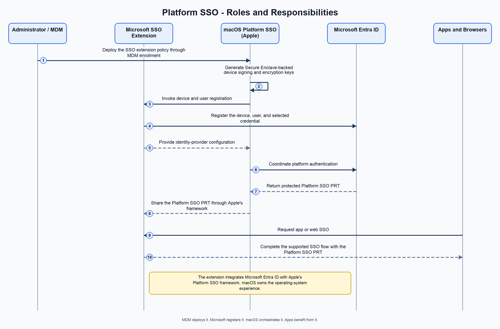
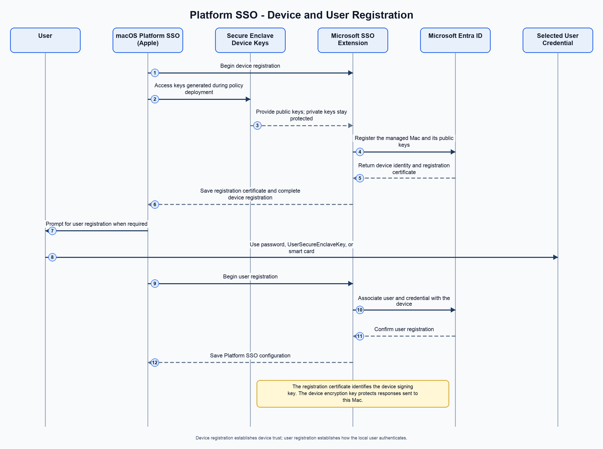
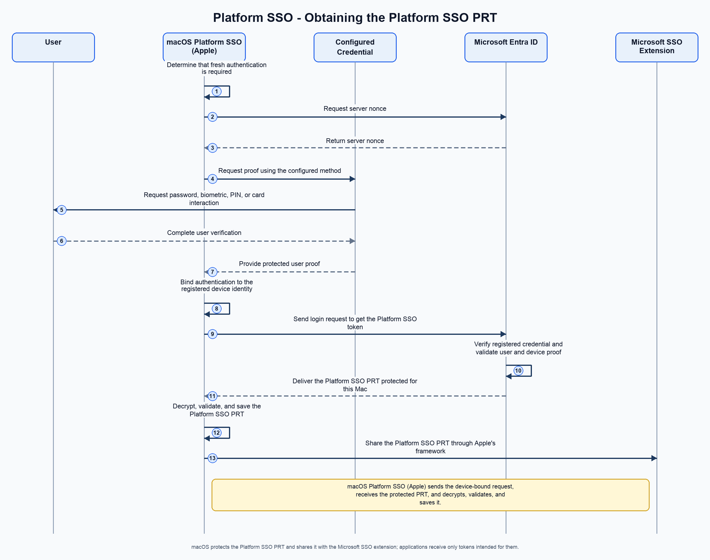
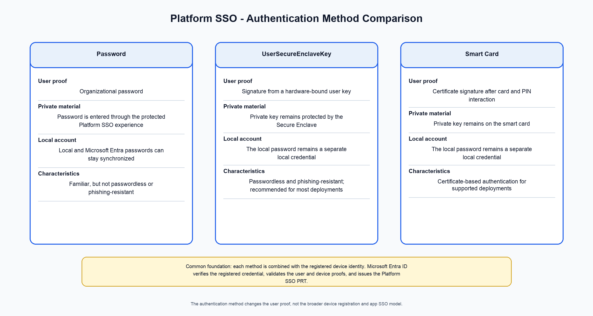
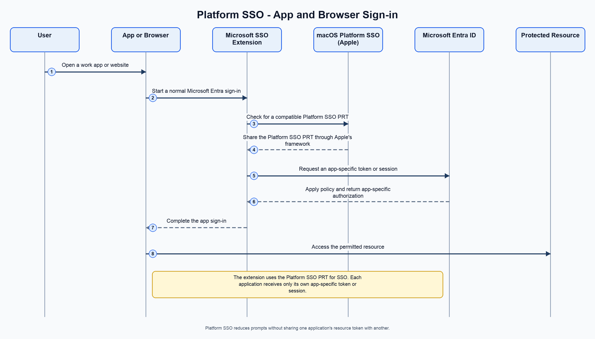
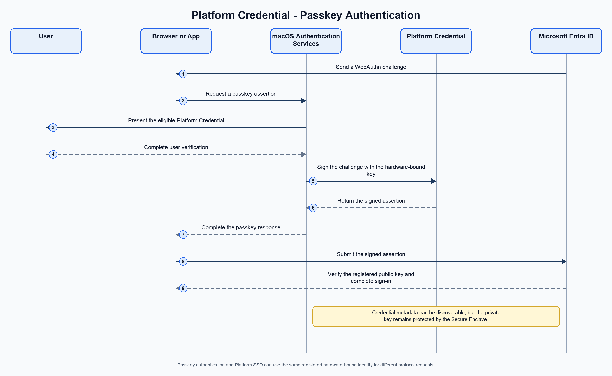

# Architecture and authentication flow for macOS Platform SSO (Apple) with Microsoft Entra ID

macOS Platform Single Sign-on (PSSO) integrates a user's organizational identity with macOS. When PSSO is configured with Microsoft Entra ID, a managed Mac can establish a device-bound identity, register a local user, and provide single sign-on (SSO) to supported applications and websites.

This article explains the architecture and authentication lifecycle behind that experience. It focuses on the responsibility boundaries between device management, macOS, the Microsoft Enterprise SSO plug-in, Microsoft Entra ID, and applications.

> [!IMPORTANT]
> This article is a conceptual architecture overview. Exact behavior depends on the macOS version, the configured authentication method, the Microsoft Enterprise SSO plug-in version, the mobile device management (MDM) configuration, and Microsoft Entra tenant policy.

## Roles and responsibilities

PSSO is an Apple platform capability implemented through an identity provider's SSO extension. It isn't a standalone Microsoft credential provider, and applications don't implement the device and user registration protocol themselves.

With Microsoft Entra ID:

- **The device management service** deploys the Extensible SSO policy and PSSO configuration.
- **The Microsoft Enterprise SSO plug-in** registers the Mac and user with Microsoft Entra ID and supplies the identity-provider configuration required by macOS.
- **macOS Platform SSO (Apple)** owns the operating-system experience. It invokes registration, protects platform credentials, coordinates authentication, and makes the resulting Platform SSO PRT available to the Microsoft SSO extension through Apple's supported framework.
- **Microsoft Entra ID** registers the device and user credential, verifies the registered credential, validates the user and device proofs, and issues the Platform SSO Primary Refresh Token (PRT).
- **Applications and browsers** request access to resources and receive only the tokens or sessions intended for them.

*Figure 1. Device management deploys PSSO, Microsoft registers the device and user, macOS orchestrates authentication, and applications benefit from SSO.*

## Components

| Component | Primary responsibility |
| --- | --- |
| Microsoft Intune or another supported MDM | Deploy the Extensible SSO configuration and select the PSSO authentication method |
| Company Portal for macOS | Deliver the Microsoft Enterprise SSO plug-in used for Microsoft Entra PSSO |
| Microsoft Enterprise SSO plug-in | Perform Microsoft Entra device and user registration and provide identity-provider configuration to macOS |
| macOS Platform SSO (Apple) | Coordinate registration and authentication, protect platform credentials, and integrate the organizational identity with macOS |
| Microsoft Entra ID | Register the device and credential, verify the registered credential, validate the user and device proofs, and issue the Platform SSO PRT |
| Secure Enclave | Protect device-bound keys and, with the UserSecureEnclaveKey method, the user-bound key |
| Apps and browsers | Request resource tokens or web sessions backed by the Platform SSO foundation |

## Policy deployment and device keys

Before registration begins, the Mac receives an Extensible SSO configuration through MDM. The configuration identifies the SSO extension and contains the organization's PSSO settings, including the selected authentication method and registration behavior.

When the device is MDM enrolled and the SSO extension policy with PSSO configuration is deployed, macOS generates two Secure Enclave-backed device keys:

- **Device signing key:** Signs device-bound PSSO requests.
- **Device encryption key:** Enables Microsoft Entra ID to protect responses so that only the registered Mac can recover them.

This key-generation step occurs before Microsoft Entra device registration. Registration accesses the existing keys; it doesn't generate them as part of the service exchange. The private keys remain protected on the Mac and aren't exported to applications or Microsoft Entra ID.

## Device registration

Device registration establishes the Mac as a known Microsoft Entra device:

1. macOS invokes the Microsoft Enterprise SSO plug-in.
2. macOS makes the previously generated device signing and encryption keys available through the PSSO framework.
3. The extension creates device-registration proof and sends the required public-key material to Microsoft Entra ID.
4. Microsoft Entra ID validates the request and creates or updates the device identity.
5. Microsoft Entra ID returns a **registration certificate** associated with the device signing public key.
6. The extension saves the registration certificate through the PSSO framework and completes registration.

The registration certificate contains the device signing public key and binds it to the registered device identity. It isn't the private signing key and it isn't the user's authentication credential.

## User registration

User registration associates the local macOS user with a Microsoft Entra identity and provisions the authentication method selected by the administrator.

The supported methods are:

- Password
- UserSecureEnclaveKey
- Smart Card

With the UserSecureEnclaveKey method, user registration also provisions a hardware-bound user key:

1. The user completes Microsoft Entra authentication and any required multifactor authentication.
2. macOS creates or accesses a user key protected by the Secure Enclave.
3. The public key is registered with Microsoft Entra ID and associated with the user and device.
4. The private key remains protected on the Mac.
5. The extension completes the user's PSSO configuration.

*Figure 2. Device registration establishes device trust; user registration associates a user and authentication method with the Mac.*

## Identity-provider configuration

After registration, the Microsoft extension supplies macOS with the configuration required to operate the Microsoft Entra authentication protocol. Conceptually, this configuration identifies:

- The Microsoft Entra authority and endpoints.
- The registered user.
- The active authentication method.
- The application, audience, and scopes used by the protocol.
- The requirements for validating service responses.
- The representation of method-specific authentication proof.

macOS persists this information through Apple's PSSO framework. This arrangement allows macOS to coordinate login, unlock, account management, credential refresh, and System Settings experiences while Microsoft remains responsible for Microsoft Entra registration and service-specific validation.

## Obtain the Platform SSO PRT

The Microsoft Entra SSO credential used by PSSO is a hardware-bound PRT. The user proof differs by authentication method, but the high-level flow is shared:

1. macOS determines that the Platform SSO PRT must be obtained or refreshed.
2. macOS loads the identity-provider configuration saved during registration.
3. macOS obtains anti-replay information from Microsoft Entra ID.
4. macOS collects or invokes the configured user proof.
5. macOS binds authentication to the registered device identity.
6. Microsoft Entra ID verifies the registered credential and validates the user and device proofs.
7. Microsoft Entra ID returns the Platform SSO PRT protected for the registered Mac.
8. macOS decrypts, validates, and saves the Platform SSO PRT using operating-system protections.
9. macOS makes the PRT available to the Microsoft SSO extension through Apple's PSSO framework.
10. The extension uses the PRT to obtain app-specific tokens or complete supported web SSO.

The user's password, private key used by UserSecureEnclaveKey, or smart-card private key isn't converted into a PRT. Those credentials prove the user's identity. Microsoft Entra ID issues the PRT after validating that proof and the registered device context.

*Figure 3. macOS sends the device-bound authentication request, protects the returned Platform SSO PRT, and shares it with the Microsoft SSO extension.*

## Authentication methods

The authentication method changes how the user proves identity. It doesn't change the broader device-registration and app-SSO architecture.

### Password

The Microsoft Entra password and local macOS password are synchronized according to PSSO policy. The authentication request remains bound to the registered Mac. This method reduces the number of passwords the user manages, but it isn't passwordless or phishing-resistant.

### UserSecureEnclaveKey

A hardware-bound user key is protected by the Secure Enclave. When fresh proof is required, macOS requests a signature from the private key and Microsoft Entra ID verifies it with the registered public key. The private key doesn't leave the Mac. The local account password remains a separate local credential.

Microsoft recommends the UserSecureEnclaveKey auth method for most PSSO deployments.

### SmartCard

The user proves identity with a certificate and its associated private key. The user completes the required card and PIN interaction, and the smart card signs the authentication proof without exporting the private key. Microsoft Entra certificate-based authentication validates the certificate, signature, user mapping, registered device, and policy.

*Figure 4. Password, UserSecureEnclaveKey, and Smart Card are alternative methods for producing user authentication proof.*

## Application and browser SSO

Applications don't receive the user's private keys, registration certificate, or Platform SSO PRT.

A supported app or browser starts a normal Microsoft Entra authentication operation. The Microsoft Enterprise SSO plug-in checks whether macOS has a compatible Platform SSO PRT. If one is available, the extension uses it to request an app-specific token or complete the supported web SSO flow.

The resulting resource token remains scoped to the requesting client and resource. PSSO provides the reusable device and user authentication foundation; it doesn't give one application access to another application's tokens.

*Figure 5. The extension uses the Platform SSO PRT to complete SSO while each application receives only its own authorization.*

## Platform Credentials and passkeys

Platform Credential passkey authentication is an optional related capability. It isn't required to obtain or use the Platform SSO PRT.

With supported Microsoft Entra scenarios, the Secure Enclave Platform Credential (Secure Enclave backed user key registered during PSSO with UserSecureEnclaveKey auth method) can answer a WebAuthn challenge:

1. A browser or application receives a WebAuthn challenge from Microsoft Entra ID.
2. macOS presents the eligible Platform Credential.
3. The user completes verification, such as Touch ID when required.
4. The Secure Enclave key signs the WebAuthn assertion.
5. Microsoft Entra ID verifies the assertion using the registered public key.

*Figure 6. A passkey operation uses the registered hardware-bound credential for WebAuthn without exporting its private key.*

Routine PRT acquisition and passkey authentication can use the same registered hardware-backed identity, but they answer different protocol requests:

- PSSO authentication obtains or refreshes the Platform SSO PRT.
- Passkey authentication answers a WebAuthn challenge for a relying party.

## Complete lifecycle

The complete conceptual lifecycle is:

1. MDM enrollment deploys the SSO extension policy and PSSO configuration.
2. macOS generates the Secure Enclave-backed device signing and encryption keys.
3. macOS invokes the extension for device registration.
4. Microsoft Entra ID registers the device public keys and returns the device identity and registration certificate.
5. macOS invokes user registration.
6. The user registers the configured Password, UserSecureEnclaveKey, or Smart Card method.
7. The extension saves the Microsoft Entra identity-provider configuration through Apple's PSSO framework.
8. macOS obtains, validates, and protects the Platform SSO PRT.
9. macOS shares the PRT with the Microsoft SSO extension through Apple's framework.
10. Supported applications and browsers use the extension to obtain their own tokens or sessions.
11. When policy requires new proof, macOS invokes the configured authentication method again.
12. With UserSecureEnclaveKey, the Platform Credential can also answer supported WebAuthn passkey challenges.

## Related content

- [macOS Platform Single Sign-on (PSSO) overview](macos-psso.md)
- [Configure Platform SSO for macOS devices in Microsoft Intune](/intune/device-configuration/settings-catalog/configure-platform-sso-macos)
- [Configure Platform SSO during Automated Device Enrollment](/intune/device-configuration/settings-catalog/configure-platform-sso-during-enrollment)
- [Microsoft Enterprise SSO plug-in for Apple devices](../../identity-platform/apple-sso-plugin.md)
- [Apple Platform Single Sign-on deployment guide](https://support.apple.com/guide/deployment/platform-sso-for-mac-dep7bbb05313/web)
- [Passkeys in Microsoft Entra ID](../authentication/concept-authentication-passkeys-fido2.md)
- [Microsoft Entra certificate-based authentication on Apple devices](../authentication/concept-certificate-based-authentication-mobile-ios.md)
