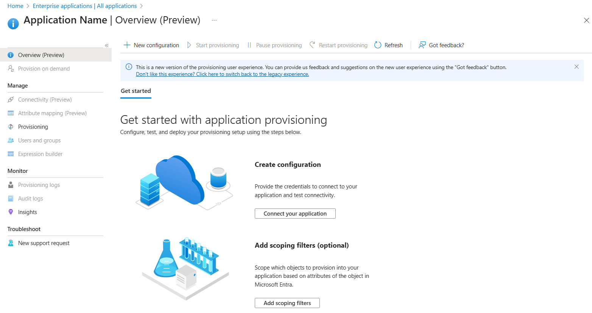
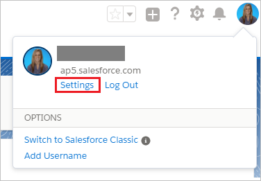
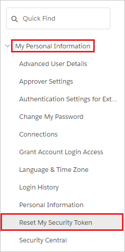
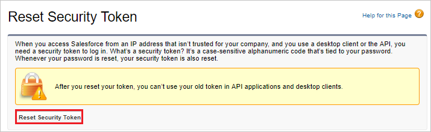
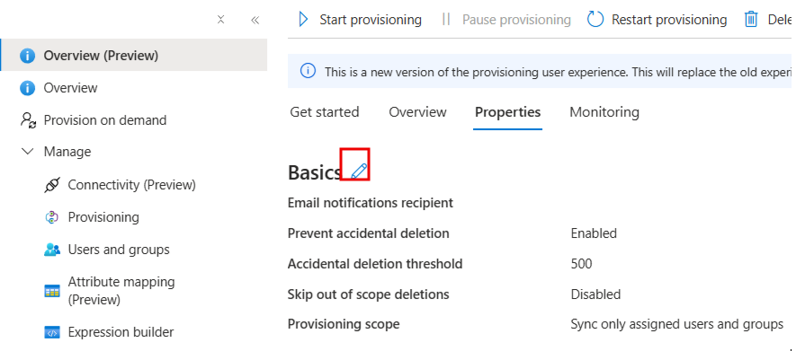

---
title: Configure Salesforce Sandbox for automatic user provisioning with Microsoft Entra ID
description: Learn the steps you need to perform in Salesforce Sandbox and Microsoft Entra ID to automatically provision and de-provision user accounts from Microsoft Entra ID to Salesforce Sandbox.
ms.topic: how-to
ms.date: 10/30/2026
ms.custom: sfi-image-nochange, msecd-doc-authoring-1032
ai-usage: ai-assisted
# Customer intent: As an IT administrator, I want to learn how to automatically provision and deprovision user accounts from Microsoft Entra ID to Salesforce Sandbox so that I can streamline the user management process and ensure that users have the appropriate access to Salesforce Sandbox.
--- 
# Configure Salesforce Sandbox for automatic user provisioning with Microsoft Entra ID

The objective of this article is to show you the steps you need to perform in Salesforce Sandbox and Microsoft Entra ID to automatically provision and de-provision user accounts from Microsoft Entra ID to Salesforce Sandbox.

## Prerequisites

The scenario outlined in this article assumes that you already have the following items:

*   A Microsoft Entra tenant.
*   A valid tenant for Salesforce Sandbox for Work or Salesforce Sandbox for Education. You may use a free trial     account for either service.
*   A user account in Salesforce Sandbox with Team Admin permissions.
*   SOAP API `login()` enabled in your Salesforce Sandbox org. Salesforce disables this operation by default for orgs created in Winter '26 and later. In Salesforce Setup, enter **User Interface** in the Quick Find box, select **User Interface**, and select **Enable SOAP API login()**. This action can't be reverted on the **User Interface** page. For details, see the Salesforce [SOAP API login() reference](https://developer.salesforce.com/docs/platform/api/guide/sforce-api-calls-login.html).
*   A profile for the integration account entered in **Admin Username** with **API Enabled**, **Manage Users**, and **Use Any API Auth** enabled.

The **Admin Username** account needs **Use Any API Auth** because the Microsoft Entra provisioning service signs in through SOAP API `login()`. Salesforce's Winter '27 release update requires this permission for SOAP API sign-ins in all orgs, including sandboxes, from December 1, 2026. For details, see [Assign Use Any API Auth Permission for SOAP login()](https://help.salesforce.com/s/articleView?id=release-notes.rn_api_soap_login.htm&language=en_US&type=5).

## Assigning users to Salesforce Sandbox

Microsoft Entra ID uses a concept called "assignments" to determine which users should receive access to selected apps. In the context of automatic user account provisioning, only the users and groups that have been "assigned" to an application in Microsoft Entra ID are synchronized.

Before configuring and enabling the provisioning service, you need to decide which users or groups in Microsoft Entra ID need access to your Salesforce Sandbox app. After you've made this decision, you can assign these users to your Salesforce Sandbox app by following the instructions in [Assign a user or group to an enterprise app](~/identity/enterprise-apps/assign-user-or-group-access-portal.md)

### Important tips for assigning users to Salesforce Sandbox

* It's recommended that a single Microsoft Entra user is assigned to Salesforce Sandbox to test the provisioning configuration. Additional users and/or groups may be assigned later.

* When assigning a user to Salesforce Sandbox, you must select a valid user role. The "Default Access" role doesn't work for provisioning.

> [!NOTE]
> The Salesforce Sandbox app will, by default, append a string to the username and email of the users provisioned. Usernames and Emails have to be unique across all of Salesforce so this is to prevent creating real user data in the sandbox which would prevent these users being provisioned to the production Salesforce environment 

> [!NOTE]
> This app imports custom roles from Salesforce Sandbox as part of the provisioning process, which the customer may want to select when assigning users.

## Enable automated user provisioning

This section guides you through connecting your Microsoft Entra ID to Salesforce Sandbox's user account provisioning API, and configuring the provisioning service to create, update, and disable assigned user accounts in Salesforce Sandbox based on user and group assignment in Microsoft Entra ID.

>[!Tip]
>You may also choose to enabled SAML-based Single Sign-On for Salesforce Sandbox, following the instructions provided in the [Azure portal](https://portal.azure.com). Single sign-on can be configured independently of automatic provisioning, though these two features complement each other.

### Configure automatic user account provisioning

The objective of this section is to outline how to enable user provisioning of Active Directory user accounts to Salesforce Sandbox.

1. Sign in to the [Microsoft Entra admin center](https://entra.microsoft.com) as at least a [Cloud Application Administrator](~/identity/role-based-access-control/permissions-reference.md#cloud-application-administrator).
1. Browse to **Entra ID** > **Enterprise apps**.

1. If you have already configured Salesforce Sandbox for single sign-on, search for your instance of Salesforce Sandbox using the search field. Otherwise, select **Add** and search for **Salesforce Sandbox** in the application gallery. Select Salesforce Sandbox from the search results, and add it to your list of applications.

1. Select your instance of Salesforce Sandbox, then select the **Provisioning** tab.

1. Select **+ New configuration**.

	

1. Under the **Admin Credentials** section, provide the following configuration settings:
   
    1. In the **Admin Username** textbox, type a Salesforce Sandbox account name that has the **System Administrator** profile in Salesforce.com assigned.
   
    1. In the **Admin Password** textbox, type the password for this account.

1. To get your Salesforce Sandbox security token, open a new tab and sign into the same Salesforce Sandbox admin account. On the top right corner of the page, select your name, and then select **Settings**.

     

1. On the left navigation pane, select **My Personal Information** to expand the related section, and then select **Reset My Security Token**.
  
    

1. On the **Reset Security Token** page, select the **Reset Security Token** button.

    

1. Check the email inbox associated with this admin account. Look for an email from Salesforce Sandbox.com that contains the new security token.

1. Copy the token, go to your Microsoft Entra window, and paste it into the **Secret Token** field.

1. Select **Test Connection** to ensure Microsoft Entra ID can connect to your Salesforce Sandbox app.

1. Select **Create** to create your configuration.

1. Select **Properties** on the **Overview** page.

1. Select the **Edit** icon to edit the properties. Enable notification emails and provide an email to receive quarantine emails. Enable accidental deletions prevention. Select **Apply** to save the changes.

   

1. Select **Attribute Mapping** in the left panel and select **users**.

1. Review the user attributes that are synchronized from Microsoft Entra ID to Salesforce Sandbox. The attributes selected as **Matching** properties are used to match the user accounts in Salesforce Sandbox for update operations. Select the Save button to commit any changes.

1. To configure scoping filters, refer to the following instructions provided in the [Scoping filter article](~/identity/app-provisioning/define-conditional-rules-for-provisioning-user-accounts.md).

1. Use [on-demand provisioning](~/identity/app-provisioning/provision-on-demand.md) to validate sync with a small number of users before deploying more broadly in your organization.  

1. When you're ready to provision, select **Start Provisioning** from the **Overview** page.

## Monitor your deployment

[!INCLUDE [monitor-deployment.md](~/identity/saas-apps/includes/monitor-deployment.md)]

## Common issues

* If **Test Connection** fails, verify that SOAP API `login()` is enabled in the Salesforce Sandbox org and that the **Admin Username** account has **Use Any API Auth**.
* **SalesforceCredentialValidation:** If **Test Connection** reports "Your Salesforce.com credentials are invalid..." even with a correct password and a fresh security token, check the integration account's **Use Any API Auth** permission. Salesforce Login History can show successful sign-ins even when this connection fails. If the underlying error is `INSUFFICIENT_ACCESS: SOAP API login() requires the Use Any API Auth user permission`, grant **Use Any API Auth** to the integration account's profile, and then retry **Test Connection**.

## Additional resources

* [Managing user account provisioning for Enterprise Apps](tutorial-list.md)
* [What is application access and single sign-on with Microsoft Entra ID?](~/identity/enterprise-apps/what-is-single-sign-on.md)
* [Configure Single Sign-on](./salesforce-sandbox-tutorial.md)
