# Configure Secure Cloud User Integration for automatic user provisioning with Microsoft Entra ID

In this tutorial, you learn how to configure automatic user provisioning between Microsoft Entra ID and Secure Cloud. When configured, Microsoft Entra ID automatically creates, updates, and deprovisions users and groups in [Secure Cloud](https://cp.appriver.com/) using the SCIM 2.0 protocol. This reduces administrative overhead and helps ensure user access remains synchronized between Microsoft Entra ID and Secure Cloud.

For important details about what the service does, how it works, and frequently asked questions, see [Automate user provisioning and deprovisioning to SaaS applications with Microsoft Entra ID](~/identity/app-provisioning/user-provisioning.md).

## Capabilities supported

> [!div class="checklist"]
> - Create users and groups in Secure Cloud.
> - Update user and group attributes in Secure Cloud.
> - Synchronize group memberships in Secure Cloud.
> - Deprovision users and groups in Secure Cloud.
> - Sign in to Secure Cloud with Microsoft Entra ID (single sign-on).
> - Supports OAuth 2.0 client credentials authentication for provisioning from Microsoft Entra ID to Secure Cloud.

## Prerequisites

Before you begin, ensure that you have the following prerequisites:

- Single sign-on has already been configured by following [Step 3: Add Secure Cloud User Integration to your Microsoft Entra tenant](#step-3-add-secure-cloud-user-integration-to-your-microsoft-entra-tenant).
- [A Microsoft Entra tenant](~/identity-platform/quickstart-create-new-tenant.md).
- The Secure Cloud User Integration enterprise application exists in your Microsoft Entra tenant.
- A Microsoft Entra account with one of the following roles:
    - [Application Administrator](/entra/identity/role-based-access-control/permissions-reference#application-administrator).
    - [Cloud Application Administrator](/entra/identity/role-based-access-control/permissions-reference#cloud-application-administrator).
    - [Application Owner](/entra/fundamentals/users-default-permissions#owned-enterprise-applications).
- A Secure Cloud User Integration subscription that supports automatic provisioning.
- Administrator access to Secure Cloud with permission to configure provisioning.
- Access to the Secure Cloud provisioning configuration page to obtain SCIM provisioning credentials.
- A Secure Cloud User Integration user account whose email address matches the Microsoft Entra account of the administrator who grants consent in [Step 3](#step-3-add-secure-cloud-user-integration-to-your-microsoft-entra-tenant).

> [!IMPORTANT]
> The Secure Cloud User Integration enterprise application is created during the initial Microsoft Entra sign-in and consent process. Please follow the steps in sequence begining with Step 1, to make sure that before you configure automatic provisioning, the single sign-on setup and consent process in [Step 3](#step-3-add-secure-cloud-user-integration-to-your-microsoft-entra-tenant) is completed, to ensure that the enterprise application exists in your Microsoft Entra tenant.

## Step 1: Plan your provisioning deployment

1. Learn about [how the provisioning service works](~/identity/app-provisioning/user-provisioning.md).
1. Determine who is in [scope for provisioning](~/identity/app-provisioning/define-conditional-rules-for-provisioning-user-accounts.md).
1. Determine what data to [map between Microsoft Entra ID and Secure Cloud User Integration](~/identity/app-provisioning/customize-application-attributes.md).

## Step 2: Configure Secure Cloud User Integration to support provisioning with Microsoft Entra ID

1. Sign in to the [Secure Cloud User Integration admin portal](https://cp.appriver.com/) as an administrator.
1. Browse to **Service Administration** > **Account Management** > **User Integration** > **Import Plans**.

   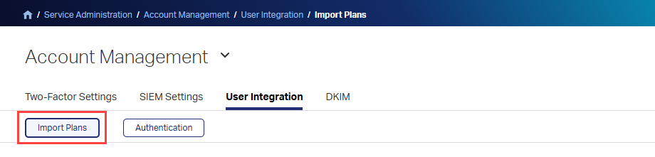

1. Select **New Microsoft Entra Plan**.

   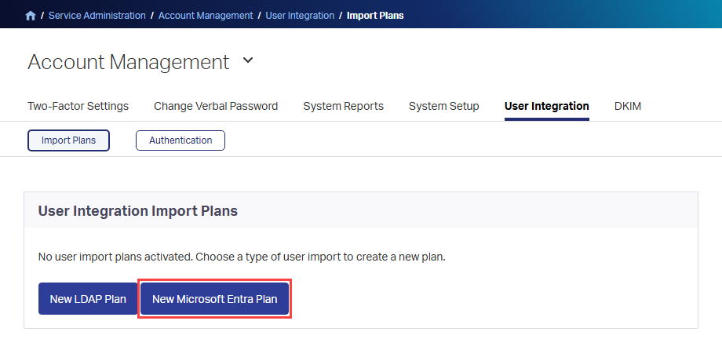

1. Under **Provisioning Settings**, turn on **Enable Microsoft Entra Provisioning**.

   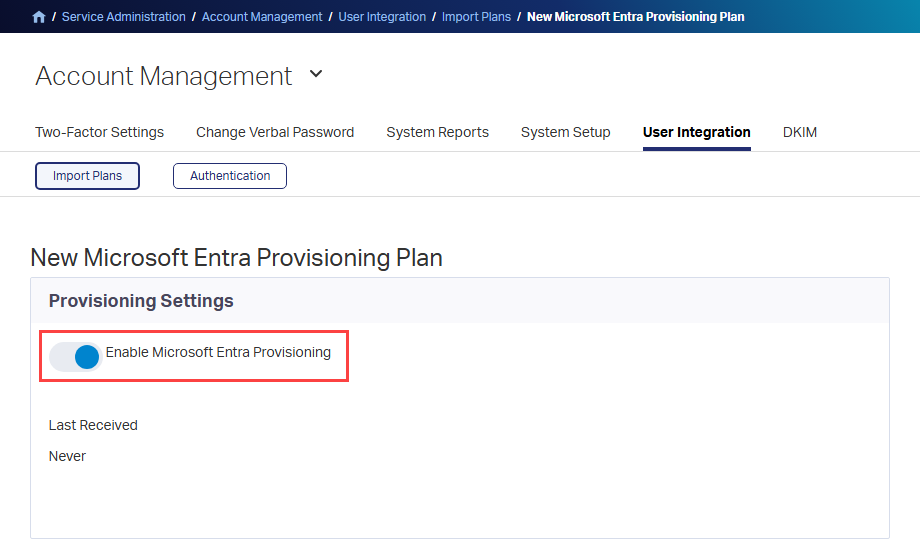

1. Under **Services**, select the services to assign to provisioned users. These services are assigned only to newly provisioned users. Existing Secure Cloud User Integration users aren't changed by this setting.

   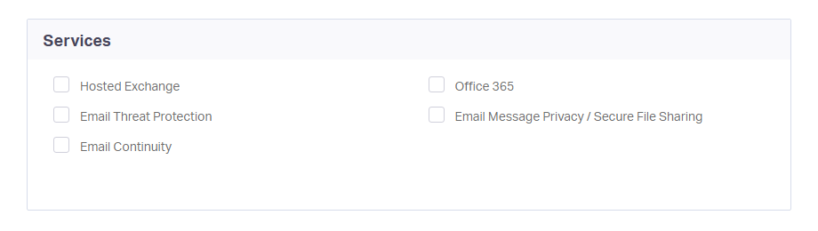

1. Optionally, under **Notifications**, select **Send Welcome Email**.

   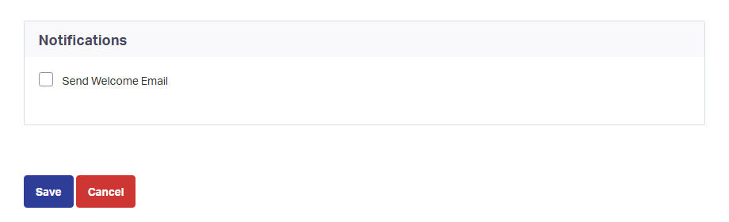

1. Select **Save**. The **Plan Details - Microsoft Entra Provisioning Plan** page opens.

   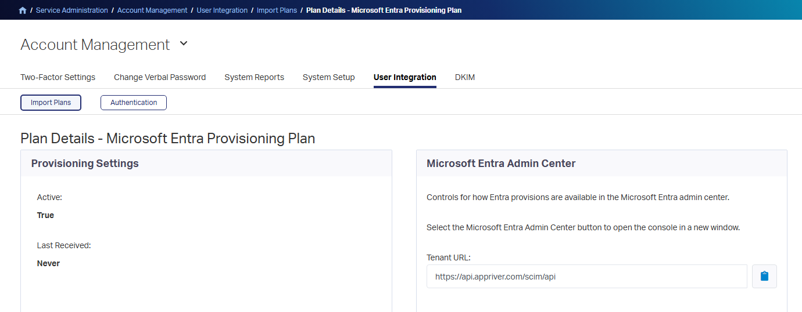

1. In the **Microsoft Entra Admin Center** section, copy the following values. You enter them in Microsoft Entra ID in [Step 5](#step-5-configure-automatic-user-provisioning-to-secure-cloud-user-integration).

   | Secure Cloud User Integration value | Microsoft Entra field |
   | --- | --- |
   | **Tenant URL**, for example `https://api.appriver.com/scim/api` | **Tenant URL** |
   | **Token Endpoint**, for example `https://account.appriver.com/identity/connect/token` | **OAuth token endpoint** |
   | **Client ID** | **Client identifier** |
   | **Client Secret** (select **Show** to reveal it) | **Client secret** |

   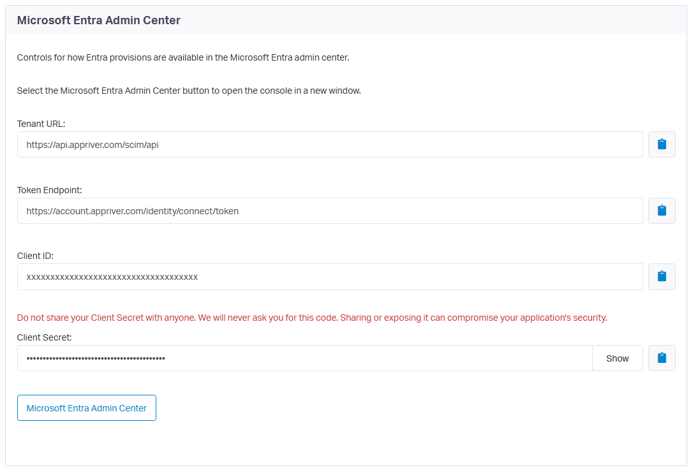

> [!IMPORTANT]
> Treat the client secret as a secret. Store it securely, and don't include a real client ID or client secret in documentation, screenshots, email, or support requests.

## Step 3: Add Secure Cloud User Integration to your Microsoft Entra tenant

The Secure Cloud User Integration enterprise application uses consent-based onboarding. The application is created in your Microsoft Entra tenant when an administrator first signs in to Secure Cloud User Integration with Microsoft Entra ID and grants consent. Complete this step to enable single sign-on and create the application that you configure for provisioning in Step 5.

### Enable Microsoft Entra authentication

1. In the [Secure Cloud User Integration admin portal](https://cp.appriver.com/), browse to **Service Administration** > **Account Management** > **User Integration** > **Authentication**.

   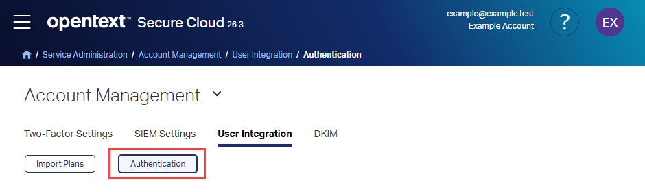

1. In the **Authentication Type** list, select **Microsoft Entra SSO**.

   

1. Under **Configuration**, turn on **Enable Microsoft Entra Authentication**.

   

1. Optionally, turn on **Fallback User Password** during initial setup. This option provides an alternate sign-in method if Microsoft Entra authentication is unavailable.

   - If **Fallback User Password** is on, users can select **Sign in with Microsoft**, or sign in with their Secure Cloud User Integration credentials or LDAP credentials, if LDAP authentication is configured.
   - If **Fallback User Password** is off, users are redirected to Microsoft Entra ID after they enter their username, and Secure Cloud User Integration or LDAP credentials can't be used.

   

1. Select **Save**.

### Sign in and grant consent

1. Sign out of Secure Cloud User Integration, or use a different browser, and go to the [Secure Cloud User Integration sign-in page](https://account.appriver.com/).

   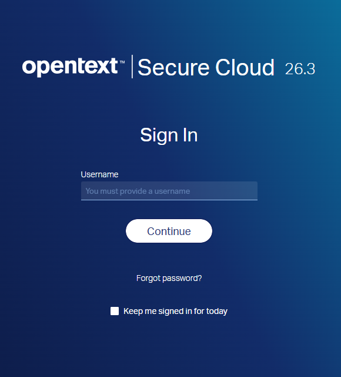

1. Enter the username of a Secure Cloud User Integration account whose email address matches a Microsoft Entra account that can grant consent to applications in the tenant, and then select **Continue**.

   

1. If **Fallback User Password** is on, select **Sign in with Microsoft** under **Use your organization's digital identity**. If it's off, you're redirected to Microsoft Entra ID automatically.

   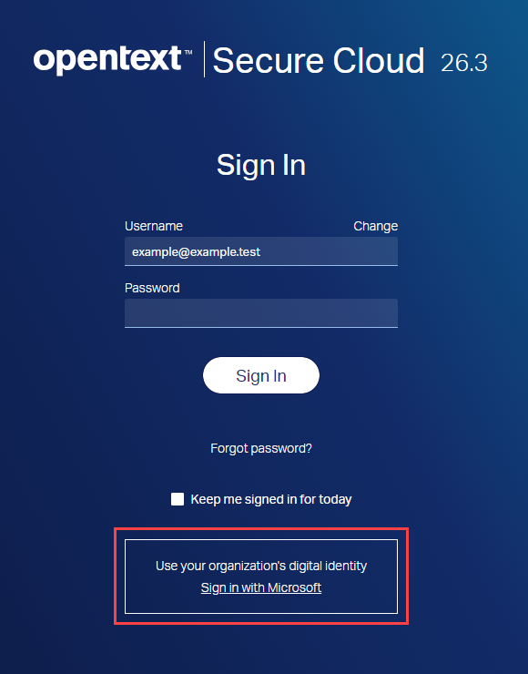

1. Sign in with your Microsoft Entra credentials and complete any multifactor authentication prompts.
1. On the **Permissions requested** page, review the requested permissions.

   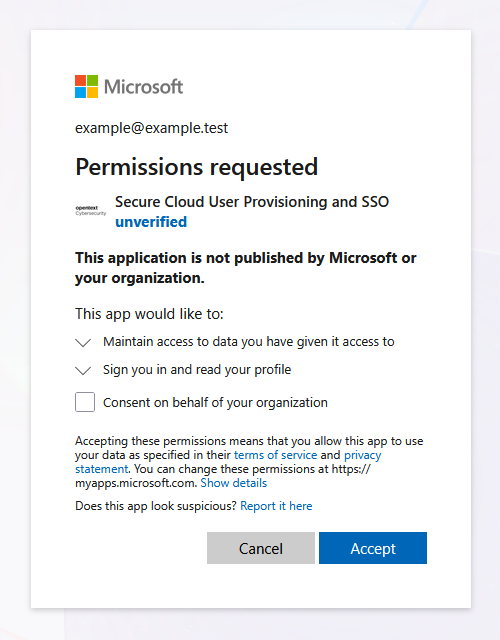

1. Optionally, select **Consent on behalf of your organization** so that users aren't prompted for consent at their first sign-in. For more information, see [Overview of user and admin consent](~/identity/enterprise-apps/user-admin-consent-overview.md).

   

1. Select **Accept**. Microsoft Entra ID creates the **Secure Cloud User Integration** enterprise application in your tenant and redirects you back to Secure Cloud User Integration, where you're signed in.
1. To confirm, sign in to the [Microsoft Entra admin center](https://entra.microsoft.com), browse to **Entra ID** > **Enterprise apps**, and search for **Secure Cloud User Integration**.

   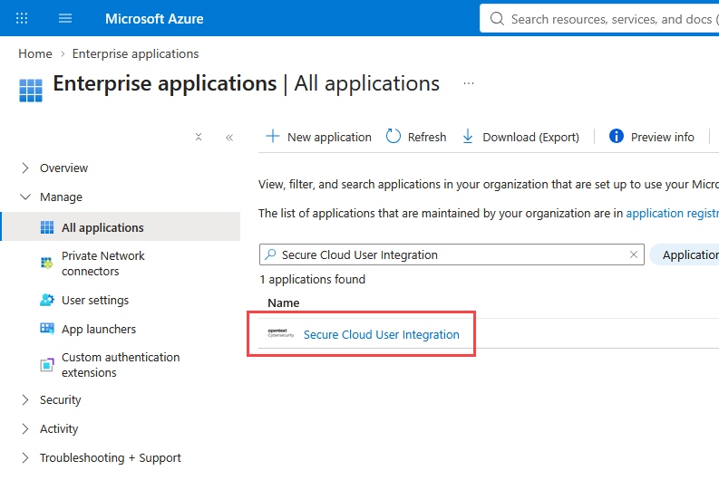

## Step 4: Define who is in scope for provisioning

[!INCLUDE [create-assign-users-provisioning.md](~/identity/saas-apps/includes/create-assign-users-provisioning.md)]

## Step 5: Configure automatic user provisioning to Secure Cloud User Integration

This section guides you through connecting Microsoft Entra ID to the Secure Cloud User Integration provisioning API. The Microsoft Entra provisioning service uses this connection to create, update, and disable assigned users and groups in Secure Cloud User Integration.

### Configure automatic user provisioning for Secure Cloud User Integration in Microsoft Entra ID

1. Sign in to the [Microsoft Entra admin center](https://entra.microsoft.com) as at least a [Cloud Application Administrator](~/identity/role-based-access-control/permissions-reference.md#cloud-application-administrator).
1. Browse to **Entra ID** > **Enterprise apps**.

   

1. In the applications list, select **Secure Cloud User Integration**.
1. Select **Provisioning**.

   

1. Select **New configuration**.

   

1. Enter the values that you copied in [Step 2](#step-2-configure-app-provisioning):

   | Microsoft Entra field | Value |
   | --- | --- |
   | **Tenant URL** | Secure Cloud User Integration **Tenant URL** |
   | **OAuth token endpoint** | Secure Cloud User Integration **Token Endpoint** |
   | **Client identifier** | Secure Cloud User Integration **Client ID** |
   | **Client secret** | Secure Cloud User Integration **Client Secret** |

1. Select **Test Connection** to ensure that Microsoft Entra ID can connect to Secure Cloud User Integration. If the connection fails, confirm that the values match those shown in the Secure Cloud User Integration provisioning plan and that **Enable Microsoft Entra Provisioning** is turned on.

1. Select **Create**.
1. On the **Provisioning** > **Overview** page, select **Properties**, and then edit **Settings**.
1. In **Notification Email**, enter an email address to receive provisioning error notifications, and enable email notification when a failure occurs.
1. Enable **Prevent accidental deletion** and set an appropriate threshold.
1. Select **Apply**.

   

1. Select **Attribute Mapping**, and then select **users**.
1. Review the user attributes that are synchronized from Microsoft Entra ID to Secure Cloud User Integration. The default user matching attribute is `userName`, sourced from `userPrincipalName`. Attributes selected as **Matching** properties are used to match user accounts in Secure Cloud User Integration for update operations. If you change the [matching target attribute](~/identity/app-provisioning/customize-application-attributes.md), ensure that the Secure Cloud User Integration API supports filtering users by that attribute. Select **Save** to commit any changes.

   | Attribute | Type | Supported for matching/filtering | Required by Secure Cloud User Integration | Notes |
   | --- | --- | --- | --- | --- |
   | `userName` | String | Yes | Yes | Mapped from `userPrincipalName`. |
   | `active` | Boolean | | | Mapped from `Switch([IsSoftDeleted], , "False", "True", "True", "False")`. |
   | `displayName` | String | | | Mapped from `displayName`. |
   | `title` | String | | | Mapped from `jobTitle`. |
   | `emails[type eq "work"].value` | String | | | Mapped from `mail`. |
   | `name.givenName` | String | | | Mapped from `givenName`. |
   | `name.familyName` | String | | | Mapped from `surname`. |
   | `externalId` | String | | | Mapped from `mailNickname`. |
   | `phoneNumbers[type eq "work"].value` | String | | | Mapped from `telephoneNumber`. |
   | `phoneNumbers[type eq "mobile"].value` | String | | | Mapped from `mobile`. |
   | `phoneNumbers[type eq "fax"].value` | String | | | Mapped from `facsimileTelephoneNumber`. |
   | `addresses[type eq "work"].streetAddress` | String | | | Mapped from `streetAddress`. |
   | `addresses[type eq "work"].locality` | String | | | Mapped from `city`. |
   | `addresses[type eq "work"].region` | String | | | Mapped from `state`. |
   | `addresses[type eq "work"].postalCode` | String | | | Mapped from `postalCode`. |
   | `addresses[type eq "work"].country` | String | | | Mapped from `country`. |
   | `urn:ietf:params:scim:schemas:extension:enterprise:2.0:User:department` | String | | | Mapped from `department`. |
   | `urn:ietf:params:scim:schemas:extension:opentext:2.0:Mailbox:proxyAddresses` | String | | | Mapped from `Join(",", [proxyAddresses])`. |

1. Select **Attribute Mapping**, and then select **groups**.
1. Review the group attributes that are synchronized from Microsoft Entra ID to Secure Cloud User Integration. The default group matching attribute is `displayName`. Attributes selected as **Matching** properties are used to match groups in Secure Cloud User Integration for update operations. Select **Save** to commit any changes.

   | Attribute | Type | Supported for matching/filtering | Required by Secure Cloud User Integration | Notes |
   | --- | --- | --- | --- | --- |
   | `displayName` | String | Yes | Yes | Mapped from `displayName`. |
   | `members` | Reference | | | Mapped from `members`. |
   | `externalId` | String | | | Mapped from `objectId`. |
   | `urn:ietf:params:scim:schemas:extension:opentext:2.0:Mailbox:proxyAddresses` | String | | | Mapped from `Join(",", [proxyAddresses])`. |

1. Set **Scope** to **Sync only assigned users and groups** (recommended). If you use **Sync all users and groups**, use scoping filters to limit which objects are provisioned. To configure scoping filters, follow the instructions in [Attribute-based application provisioning with scoping filters](~/identity/app-provisioning/define-conditional-rules-for-provisioning-user-accounts.md).
1. Use [on-demand provisioning](~/identity/app-provisioning/provision-on-demand.md) to validate initial synchronization with a small number of test users before deploying more broadly. Include a disposable test account for the deprovisioning test.
1. Keep the provisioning scope limited to your test users and groups, and select **Start Provisioning** on the **Overview** page.
1. Update a test user's attributes in Microsoft Entra ID and verify that the changes synchronize to Secure Cloud User Integration.
1. Remove the disposable test user's application assignment and allow the appropriate provisioning cycle to process the assignment removal. Verify that the user is deprovisioned according to the configured provisioning behavior. The initial on-demand provisioning operation alone doesn't validate deprovisioning.
1. Complete these validation checks before expanding the provisioning scope for broader deployment.

## Step 6: Monitor your deployment

[!INCLUDE [monitor-deployment.md](~/identity/saas-apps/includes/monitor-deployment.md)]

To confirm the results in Secure Cloud User Integration, browse to **Service Administration** > **Users** > **User Management** to check provisioned users, and to **Service Administration** > **Users** > **User Groups** to check provisioned groups and memberships.

Also verify the expected attributes and group memberships of test users before deploying more broadly.

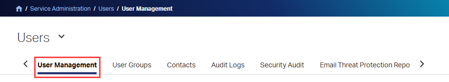

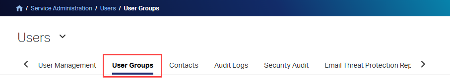

## Troubleshooting

### Secure Cloud User Integration doesn't appear in Enterprise apps

- **Cause:** The enterprise application is created only after an administrator signs in with Microsoft Entra ID and grants consent.
- **Resolution:**
  1. Repeat the sign-in in [Step 3](#step-3-add-secure-cloud-user-integration-to-your-microsoft-entra-tenant).
  1. Confirm that you selected **Accept** on the **Permissions requested** page and were redirected back to Secure Cloud User Integration.

### Users can't grant consent

- **Symptom:** Users see a message that administrator approval is required.
- **Resolution:** Check your tenant's consent settings, or ask a Cloud Application Administrator to grant consent on behalf of the organization. For more information, see [Overview of user and admin consent](~/identity/enterprise-apps/user-admin-consent-overview.md).

### A user can't sign in

- **Resolution:** Verify that the user exists in Secure Cloud User Integration, that the user's email address matches the Microsoft Entra account, and that **Enable Microsoft Entra Authentication** is turned on.

### Test Connection fails

- **Resolution:**
  1. Confirm that the Tenant URL, token endpoint, client ID, and client secret were copied exactly from the Secure Cloud User Integration provisioning plan.
  1. Confirm that **Enable Microsoft Entra Provisioning** is turned on in the plan.
  1. Confirm that network access to the Secure Cloud User Integration SCIM endpoint is available.

### Users or groups aren't provisioned

- **Resolution:**
  1. Confirm that provisioning status is set to **On**.
  1. Confirm that the users or groups are assigned directly to the **Secure Cloud User Integration** application and are in the configured scope.
  1. Check the [provisioning logs](~/identity/monitoring-health/concept-provisioning-logs.md) for errors.

### Known limitations

- Microsoft Entra ID doesn't provision users who are members of an assigned group only through nested groups. Assign all required users, or the groups that directly contain them, to the application.
- Services selected in the Secure Cloud User Integration provisioning plan are assigned only to newly provisioned users. Existing users aren't changed.

## Additional resources

- [Manage user account provisioning for enterprise apps](~/identity/app-provisioning/configure-automatic-user-provisioning-portal.md)
- [What is application access and single sign-on with Microsoft Entra ID?](~/identity/enterprise-apps/what-is-single-sign-on.md)

## Related content

- [Review logs and get reports on provisioning activity](~/identity/app-provisioning/check-status-user-account-provisioning.md)
