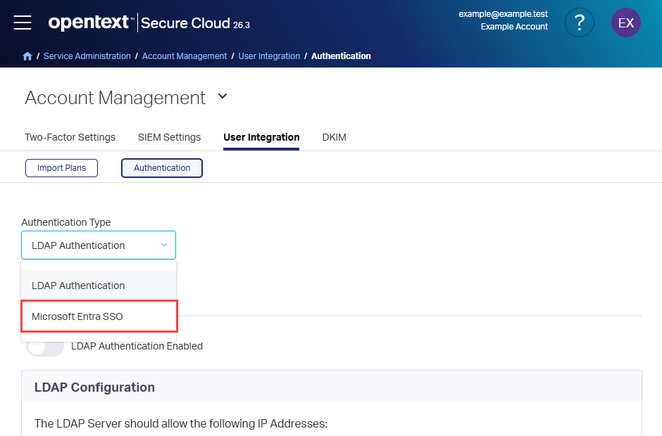
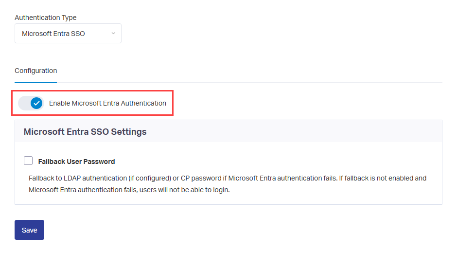
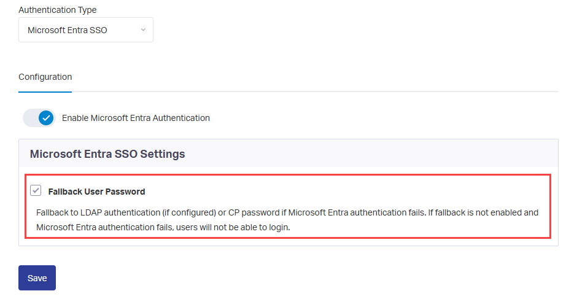
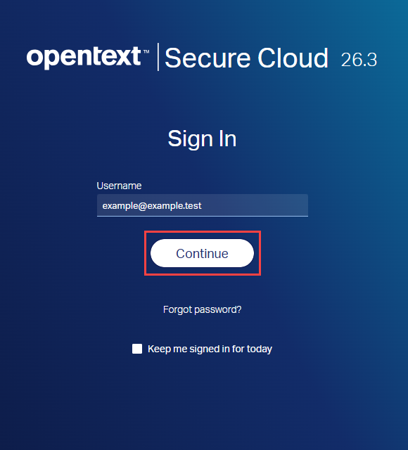
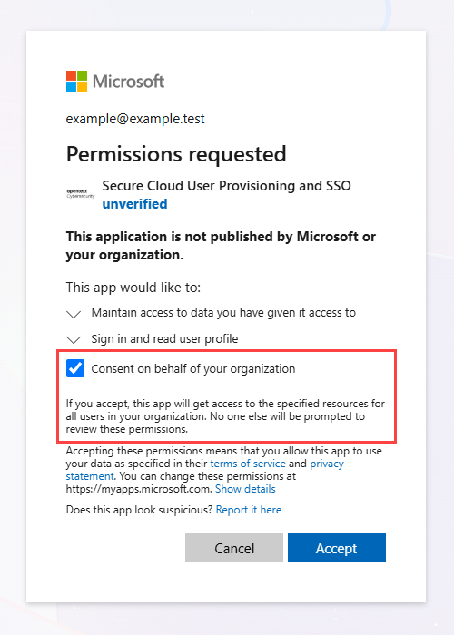

# Configure Secure Cloud User Integration for single sign-on with Microsoft Entra ID

In this article, you learn how to configure single sign-on (SSO) between Microsoft Entra ID and Secure Cloud using OpenID Connect (OIDC). When you integrate Secure Cloud with Microsoft Entra ID, users can sign in with their Microsoft Entra accounts, and administrators can centrally manage access.

The **Secure Cloud User Integration** enterprise application is created in your Microsoft Entra tenant during the initial Microsoft Entra sign-in and consent process.

## Prerequisites

Before you begin, ensure that you have the following prerequisites:

- [A Microsoft Entra tenant](~/identity-platform/quickstart-create-new-tenant.md).
- A Microsoft Entra account with one of the following roles or ownership permissions:
    - [Application Administrator](~/identity/role-based-access-control/permissions-reference.md#application-administrator).
    - [Cloud Application Administrator](~/identity/role-based-access-control/permissions-reference.md#cloud-application-administrator).
    - [Application owner](~/fundamentals/users-default-permissions.md#owned-enterprise-applications).
- An account authorized to grant the required application consent in your tenant. The ability to manage an application doesn't by itself determine whether you can grant consent. For more information, see [Overview of user and admin consent](~/identity/enterprise-apps/user-admin-consent-overview.md).
- A [Secure Cloud](https://cp.appriver.com/) administrator account.
- A Secure Cloud user account whose email address matches the Microsoft Entra account that you use for the initial setup.

> [!IMPORTANT]
> Secure Cloud User Integration uses consent-based onboarding. The enterprise application doesn't exist in your tenant until an administrator completes the initial Microsoft Entra sign-in and grants consent. Follow the setup steps in order before looking for the application in Microsoft Entra ID.

## Scenario description

In this article, you enable Microsoft Entra authentication in Secure Cloud, sign in with Microsoft Entra credentials, grant consent, and verify SSO.

- Secure Cloud supports service provider (SP)-initiated and identity provider (IdP)-initiated SSO.
- Secure Cloud uses OpenID Connect (OIDC) for Microsoft Entra ID authentication.
- Secure Cloud also supports automatic user provisioning.

## Step 1: Enable Microsoft Entra authentication

Configure authentication in Secure Cloud before you initiate the first Microsoft Entra sign-in.

1. Sign in to [Secure Cloud](https://cp.appriver.com/) as an administrator.
1. Browse to **Service Administration** > **Account Management** > **User Integration** > **Authentication**.

    

1. In the **Authentication Type** list, select **Microsoft Entra SSO**.

    

1. Under **Configuration**, turn on **Enable Microsoft Entra Authentication**.

    

1. Optionally, enable **Fallback User Password** during initial setup. This option provides an alternate sign-in method if Microsoft Entra authentication is unavailable.

    - If **Fallback User Password** is enabled, users can select **Sign in with Microsoft**, or sign in with their Secure Cloud credentials or LDAP credentials, if LDAP authentication is configured.
    - If **Fallback User Password** is disabled, users are redirected to Microsoft Entra ID after entering their username. Secure Cloud credentials and LDAP credentials aren't available as alternate sign-in methods.

    

1. Select **Save**.

## Step 2: Initiate Microsoft Entra sign-in

Start the sign-in flow from Secure Cloud.

1. Sign out of Secure Cloud, or use a different browser, and go to the [Secure Cloud sign-in page](https://account.appriver.com/).

    

1. Enter the username of a Secure Cloud account whose email address matches a Microsoft Entra account authorized to grant consent in your tenant, and then select **Continue**.

    

1. Continue according to your **Fallback User Password** setting:

    - If it's disabled, you're redirected to Microsoft Entra ID automatically.
    - If it's enabled, select **Sign in with Microsoft** under **Use your organization's digital identity**.

    

## Step 3: Authenticate with Microsoft Entra ID

Secure Cloud redirects you to the Microsoft identity platform sign-in experience.

1. Enter your Microsoft Entra credentials.
1. Complete any required multifactor authentication prompts.
1. Continue to the consent screen.

If consent has already been granted, you might be signed in without another consent prompt. In that case, continue to [Step 5](#step-5-complete-sign-in).

## Step 4: Grant consent to the application

If consent hasn't already been granted, the **Permissions requested** page appears.

1. Review the requested permissions.

    

1. Optionally, select **Consent on behalf of your organization** if you're authorized to grant tenant-wide admin consent. This grants consent for users in the tenant so that they aren't prompted to grant the same consent individually.

    

1. Select **Accept**.

After consent is granted, Microsoft Entra ID creates the **Secure Cloud User Integration** enterprise application in your tenant.

> [!IMPORTANT]
> If organizational consent isn't granted, users might be prompted to consent individually during their first sign-in, depending on your tenant's consent policies.

For more information, see [Consent experience for applications in Microsoft Entra ID](~/identity-platform/application-consent-experience.md) and [Overview of user and admin consent](~/identity/enterprise-apps/user-admin-consent-overview.md).

## Step 5: Complete sign-in

After consent is granted, Microsoft Entra ID redirects you back to Secure Cloud. Secure Cloud validates the authentication response and signs you in with your Microsoft Entra account.

The enterprise application created during consent is used for subsequent SSO and provisioning configuration.

## Step 6: Verify enterprise application creation

Confirm that the initial sign-in and consent process created the application.

1. Sign in to the [Microsoft Entra admin center](https://entra.microsoft.com) as at least a [Cloud Application Administrator](~/identity/role-based-access-control/permissions-reference.md#cloud-application-administrator).
1. Browse to **Entra ID** > **Enterprise apps**.
1. Search for **Secure Cloud User Integration** and confirm that the application appears in the list.

    

## Test single sign-on

Verify that you can sign in to Secure Cloud with your Microsoft Entra account.

1. Sign out of Secure Cloud.
1. Return to [Secure Cloud](https://cp.appriver.com/).
1. Enter the username of the Secure Cloud account that matches your Microsoft Entra account, and then select **Continue**.
1. If **Fallback User Password** is enabled, select **Sign in with Microsoft** under **Use your organization's digital identity**. If it's disabled, you're redirected to Microsoft Entra ID automatically.
1. Authenticate with your Microsoft Entra account.

If authentication succeeds, you're redirected to the Secure Cloud portal and signed in without being prompted for a Secure Cloud password.

## Troubleshooting

Use the following checks if application creation, consent, or sign-in doesn't complete as expected.

### The enterprise application doesn't appear

The application is created only after an administrator completes the initial Microsoft Entra sign-in and consent process.

- Verify that the Microsoft Entra sign-in process completed successfully.
- Verify that you selected **Accept** on the consent page.
- Verify that your browser redirected you back to Secure Cloud.
- If needed, repeat the [initial sign-in](#step-2-initiate-microsoft-entra-sign-in) and consent process.

### Users can't grant consent

If users see a message that administrator approval is required:

- Check the tenant's consent settings.
- Contact a Microsoft Entra administrator authorized to grant the required consent.
- Have an authorized administrator review the requested permissions and grant consent on behalf of the organization.

For more information, see [Overview of user and admin consent](~/identity/enterprise-apps/user-admin-consent-overview.md).

### A user can't sign in

Verify the following settings:

- The user exists in Secure Cloud.
- The Secure Cloud user's email address matches the Microsoft Entra account.
- **Enable Microsoft Entra Authentication** is turned on in Secure Cloud.
- The sign-in path matches the configured **Fallback User Password** setting.

## Related content

- [Consent experience for applications in Microsoft Entra ID](~/identity-platform/application-consent-experience.md).
- [Overview of user and admin consent](~/identity/enterprise-apps/user-admin-consent-overview.md).
- [Automate user provisioning and deprovisioning to SaaS applications with Microsoft Entra ID](~/identity/app-provisioning/user-provisioning.md).
