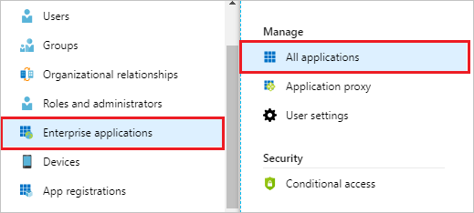
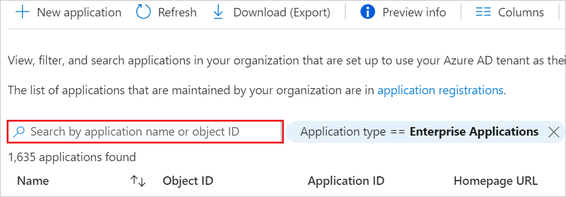
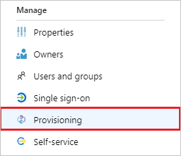
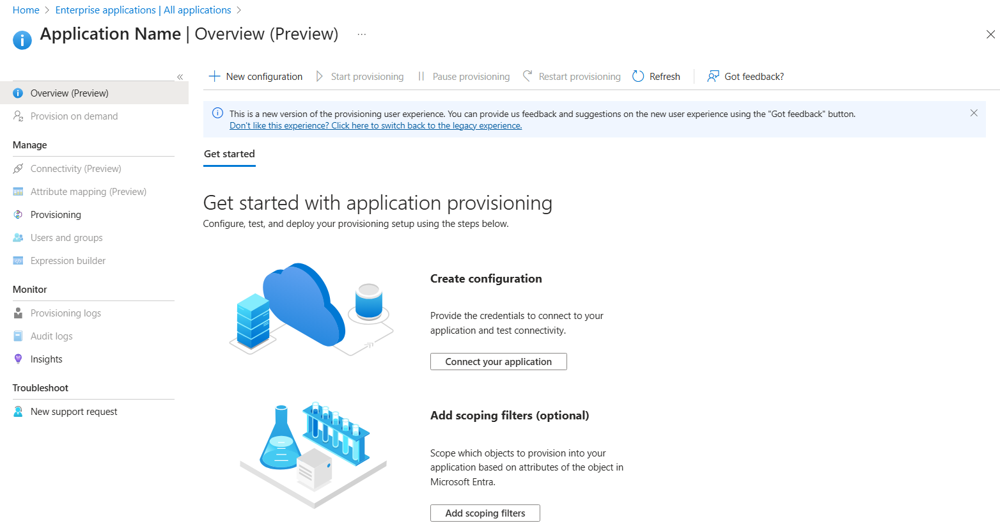
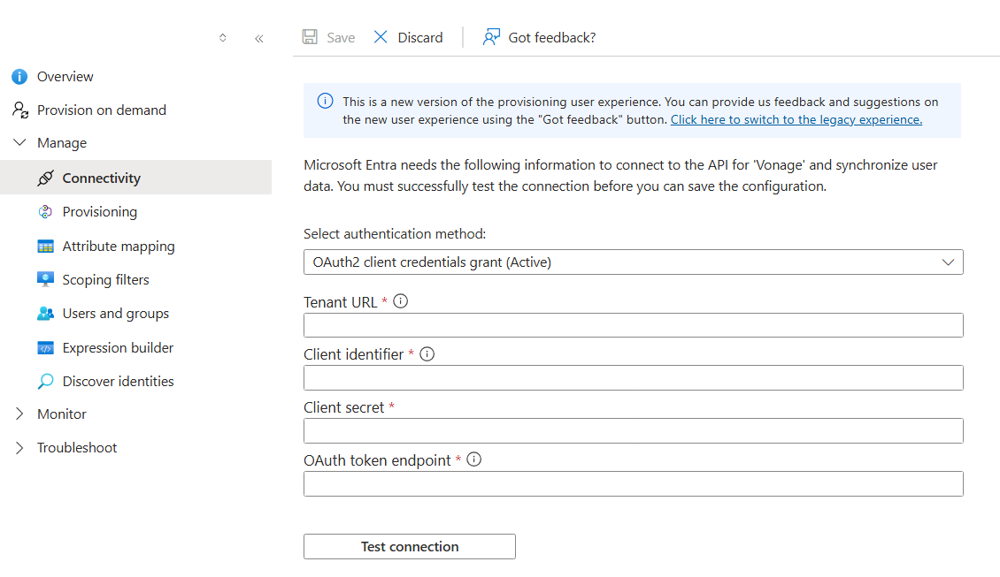
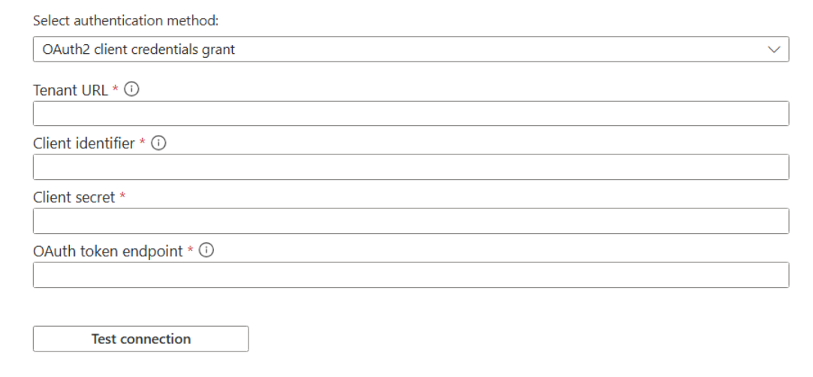
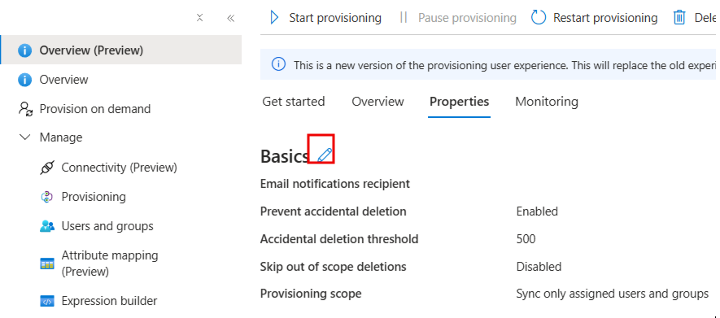

---
title: Configure Vonage for automatic user provisioning with Microsoft Entra ID
description: Learn how to automatically provision and de-provision user accounts from Microsoft Entra ID to Vonage.
ms.topic: how-to
ms.date: 10/22/2026
ms.custom: sfi-image-nochange
ai-usage: ai-assisted
# Customer intent: As an IT administrator, I want to learn how to automatically provision and deprovision user accounts from Microsoft Entra ID to Vonage so that I can streamline the user management process and ensure that users have the appropriate access to Vonage.
--- 

# Configure Vonage for automatic user provisioning with Microsoft Entra ID

This article describes the steps you need to perform in both Vonage and Microsoft Entra ID to configure automatic user provisioning. When configured, Microsoft Entra ID automatically provisions and de-provisions users and groups to [Vonage](https://www.vonage.com/) using the Microsoft Entra provisioning service. For important details on what this service does, how it works, and frequently asked questions, see [Automate user provisioning and deprovisioning to SaaS applications with Microsoft Entra ID](~/identity/app-provisioning/user-provisioning.md). 

> [!IMPORTANT]
> To improve the security posture of application provisioning, Microsoft is retiring the **OAuth 2.0 Authorization Code Grant** for this application.
>
> **Migrate affected provisioning jobs to OAuth2 Client Credentials Grant by March 31, 2027**, to avoid disruption to provisioning. After this date, provisioning jobs that continue to use Authorization Code Grant might stop working and could eventually be removed from the service.
>
> **This change doesn't affect SSO.** Existing provisioned users can continue signing in, but new users won't be provisioned and changes to existing users and groups won't be synchronized while provisioning isn't functioning.
>
> Follow the [Vonage SCIM migration guide](https://businesssupport.vonage.com/articles/Answer/SCIM-Migration-Microsoft) to migrate to OAuth2 Client Credentials Grant.

## Capabilities Supported
> [!div class="checklist"]
> * Create users in Vonage.
> * Deactivate users in Vonage when they don't require access anymore.
> * Keep user attributes synchronized between Microsoft Entra ID and Vonage.
> * [Single sign-on](vonage-tutorial.md) to Vonage (recommended).
> * OAuth 2.0 Authorization Code Grant authentication is supported until April 1, 2027. After this date, only OAuth 2.0 Client Credentials authentication is supported.

## Prerequisites

The scenario outlined in this article assumes that you already have the following prerequisites:

* [A Microsoft Entra tenant](~/identity-platform/quickstart-create-new-tenant.md). 
* One of the following roles: [Application Administrator](/entra/identity/role-based-access-control/permissions-reference#application-administrator), [Cloud Application Administrator](/entra/identity/role-based-access-control/permissions-reference#cloud-application-administrator), or [Application Owner](/entra/fundamentals/users-default-permissions#owned-enterprise-applications). 
* A [Vonage](https://www.vonage.com/) tenant.
* A user account in Vonage with Admin permissions.

## Step 1: Plan your provisioning deployment

1. Learn about [how the provisioning service works](~/identity/app-provisioning/user-provisioning.md).
1. Determine who's in [scope for provisioning](~/identity/app-provisioning/define-conditional-rules-for-provisioning-user-accounts.md).
1. Determine what data to [map between Microsoft Entra ID and Vonage](~/identity/app-provisioning/customize-application-attributes.md). 

## Step 2: Configure Vonage to support provisioning with Microsoft Entra ID

1. Log in to [Vonage admin portal](http://admin.vonage.com) with an admin user.

1. In the left navigation, select **Account** > **User Provisioning**. The **Cross-Domain Identity Management (SCIM)** settings page opens.

1. In the **Authentication Settings and Service Credentials** section, select **Microsoft Entra** as the identity provider. The **Authentication Method** dropdown is prepopulated with **OAuth 2.0 Client Credentials**.

    > [!NOTE]
    > When you change the credentials in Vonage, an existing provisioning job in Microsoft Entra ID may briefly continue using its current access token. These tokens typically expire one hour after they're issued and can't be refreshed after the credentials change in Vonage, which can cause temporary provisioning failures. Once you update the credentials in Microsoft Entra ID, subsequent sync cycles use the new credentials and retry failed provisioning operations. No additional action is needed for those failures.

1. In the **Ready to Generate Service Credentials** dialog, select **Continue**.

1. Enter one or more identity provider administrator email addresses, and select **Generate Credentials**.

1. Copy the following values from the dialog and save them in a secure location, such as a password manager. Each value has an individual copy icon.

    | Field | Description |
    | --- | --- |
    | **Token Endpoint** | The token endpoint provided by Vonage. |
    | **Tenant URL** | The tenant URL provided by Vonage. |
    | **Client ID** | The automatically generated client ID. |
    | **Client Secret ID** | The automatically generated client secret, which is visible only once. |

1. After you copy all four values, select **Done** to close the dialog.

    > [!WARNING]
    > The **Client Secret ID** is permanently masked after you select **Done**. If you lose it, select **Regenerate** to generate a new secret.

## Step 3: Add Vonage from the Microsoft Entra application gallery

Add Vonage from the Microsoft Entra application gallery to start managing provisioning to Vonage. If you have previously setup Vonage for SSO you can use the same application. However, we recommend that you create a separate app when testing out the integration initially. Learn more about adding an application from the gallery [here](~/identity/enterprise-apps/add-application-portal.md).

## Step 4: Define who is in scope for provisioning 

[!INCLUDE [create-assign-users-provisioning.md](~/identity/saas-apps/includes/create-assign-users-provisioning.md)]

## Step 5: Configure automatic user provisioning to Vonage 

> [!NOTE]
>  Any user that's added to Vonage must have first name, last name and email. Otherwise the integration will fail.

This section guides you through the steps to configure the Microsoft Entra provisioning service to create, update, and disable users and/or groups in Vonage based on user and/or group assignments in Microsoft Entra ID.

### Configure automatic user provisioning for Vonage in Microsoft Entra ID

1. Sign in to the [Microsoft Entra admin center](https://entra.microsoft.com) as at least a [Cloud Application Administrator](~/identity/role-based-access-control/permissions-reference.md#cloud-application-administrator).

1. Browse to **Entra ID** > **Enterprise apps**

	

1. In the applications list, select **Vonage**.

	

1. Select the **Provisioning** tab.

	

1. For a new configuration, select **Overview** > **+ New configuration**.

    

    To update an existing configuration, select **Connectivity**.

    

1. In **New configuration** or **Connectivity**, use the **Select authentication method** dropdown to change the authentication method. **OAuth2 client credentials grant** is selected by default for new configurations.

    > [!NOTE]
    > For existing configurations, **OAuth 2.0 Authorization Code Grant** remains available as a fallback until April 1, 2027. After this date, the option will be removed. Migrate to **OAuth2 Client Credentials Grant** by March 31, 2027, to avoid provisioning disruption.

1. **Instructions for setting up OAuth2 Client Credentials Grant:** In **Tenant URL**, enter your Vonage tenant URL. Enter the client ID, client secret, and token endpoint retrieved from the Vonage portal in **Client identifier**, **Client secret**, and **OAuth token endpoint**, respectively. Select **Test connection** to validate the credentials.

    

1. Select **Create** for a new configuration or **Save** when updating the authentication configuration.

1. Select **Properties** on the **Overview** page.

1. Select the **Edit** icon to edit the properties. Enable notification emails and provide an email to receive quarantine notifications. Enable **Accidental deletions prevention**. Select **Apply** to save the changes.

   

1. Vonage uses preset attribute mappings for user provisioning. You can view these mappings by selecting **Attribute Mapping** in the left panel and then selecting **users**. To learn whether additional attributes are supported, see the Vonage documentation.

1. To configure scoping filters, refer to the instructions provided in the [Scoping filter article](~/identity/app-provisioning/define-conditional-rules-for-provisioning-user-accounts.md).

1. Use [on-demand provisioning](~/identity/app-provisioning/provision-on-demand.md) to validate sync with a small number of users before deploying more broadly in your organization.  

1. When you're ready to provision, select **Start Provisioning** from the **Overview** page.

## Step 6: Monitor your deployment

Once you configure provisioning, use the following resources to monitor your deployment:

   1. Use the [provisioning logs](../monitoring-health/concept-provisioning-logs.md) to determine which users are provisioned successfully or unsuccessfully.
   2. Check the [progress bar](../app-provisioning/application-provisioning-when-will-provisioning-finish-specific-user.md) to see the status of the provisioning cycle and how close it's to completion.
   3. If the provisioning configuration seems to be in an unhealthy state, the application goes into quarantine. Learn more about quarantine states in the [application provisioning quarantine status](../app-provisioning/application-provisioning-quarantine-status.md) article.

## More resources

* [Managing user account provisioning for Enterprise Apps](~/identity/app-provisioning/configure-automatic-user-provisioning-portal.md)
* [What is application access and single sign-on with Microsoft Entra ID?](~/identity/enterprise-apps/what-is-single-sign-on.md)

## Related content

* [Learn how to review logs and get reports on provisioning activity](~/identity/app-provisioning/check-status-user-account-provisioning.md)
